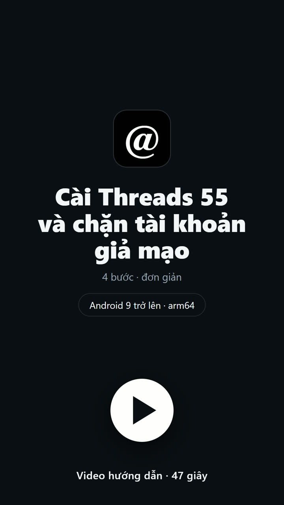

# Clone Blocker for Threads

*[Tiếng Việt](README.md) · English*

Clone Blocker patches Meta's Threads app for Android into a re-signed clone —
application ID `app.tree55.threads`, launcher label **Threads 55** — that blocks
impersonator accounts from a shared community list.

It installs *beside* official Threads rather than replacing it. Not affiliated
with Meta, and not on any app store.

## Install

<a href="https://cdn.jsdelivr.net/gh/Tree55-org/ThreadsMod@main/docs/media/threads55-install-guide.mp4"></a>

**[▶ Watch the walkthrough — 47 s](https://cdn.jsdelivr.net/gh/Tree55-org/ThreadsMod@main/docs/media/threads55-install-guide.mp4)** (Vietnamese captions; plays in the browser)
· [download the MP4](https://raw.githubusercontent.com/Tree55-org/ThreadsMod/main/docs/media/threads55-install-guide.mp4)
· [file in the repo](docs/media/threads55-install-guide.mp4).
It is an animated mockup of the UI, not footage from a device.

Download from the **[release page](https://github.com/Tree55-org/ThreadsMod/releases/tag/threads55-444.0.0.45.85-mod2)**:

| File | Size | Use |
|---|---:|---|
| [ThreadsMod-CloneBlocker-444.0.0.45.85-arm64-v8a-video-mod2.apk](https://github.com/Tree55-org/ThreadsMod/releases/download/threads55-444.0.0.45.85-mod2/ThreadsMod-CloneBlocker-444.0.0.45.85-arm64-v8a-video-mod2.apk) | 128.89 MiB | The app. Install this. |
| [ThreadsMod-CloneBlocker-444.0.0.45.85-arm64-v8a-video-mod2.zip](https://github.com/Tree55-org/ThreadsMod/releases/download/threads55-444.0.0.45.85-mod2/ThreadsMod-CloneBlocker-444.0.0.45.85-arm64-v8a-video-mod2.zip) | 85.51 MiB | The same APK, zipped. Unzip, then install. |
| [ThreadsMod-CloneBlocker-444.0.0.45.85-arm64-v8a-video-mod2-SHA256SUMS.txt](https://github.com/Tree55-org/ThreadsMod/releases/download/threads55-444.0.0.45.85-mod2/ThreadsMod-CloneBlocker-444.0.0.45.85-arm64-v8a-video-mod2-SHA256SUMS.txt) | 258 bytes | SHA-256 values for both downloads. |

Requires **Android 9 or newer**, **arm64-v8a**. You will need to allow installing
from an unknown source.

Verify the download before installing — it should be exactly:

```
SHA-256  83cc9c1cf12ae154154983ac1b4f7961e81d1e7695ee467431fc3994f0de6dae
```

```powershell
Get-FileHash -Algorithm SHA256 ThreadsMod-CloneBlocker-444.0.0.45.85-arm64-v8a-video-mod2.apk    # Windows
sha256sum ThreadsMod-CloneBlocker-444.0.0.45.85-arm64-v8a-video-mod2.apk                         # Linux / macOS
```

If the hash does not match, do not install it.

Installing over an earlier **Threads 55** keeps your data. It can never update or
replace official Threads, and an older `com.threadsmod.barcelona` build is a
separate app the updater cannot bridge.

Read [what it does](#what-it-does) and the [risks](#risks) first, and test with an
account you can afford to lose.

## What it does

- **Blocks impersonators as you scroll.** It syncs a signed community list every
  ten minutes while the app is open, and blocks a listed account when that
  account's own post or reply appears on screen — one at a time, with a random
  delay.
- **This is always on.** There is no switch. Uninstalling is the only way to stop it.
- **One Block control on every post and reply**, opening a single *Block and
  report* dialog: the post excerpt, a reason, an optional *Also block this
  profile*, and Cancel.
- **Reports are never automatic** — only an explicit tap sends one.
- **Settings and Activity screens** from the bottom of the left drawer: list
  status, record counts, the report outbox, and history.
- **Save video** in the native post menu: choose **Choose location** to save a
  supported direct MP4, up to 256 MiB. Video carousels and adaptive-only streams
  are excluded. [Details](docs/14-VIDEO-SAVING.md).
- **Optional SOCKS5 proxy** covering only this app. Off by default.
- **Signed in-app update support**, handed to Android's normal installer.
  Signed update metadata has not been deployed; install this release manually.

**Blocks are real.** They run through Threads' own block action on your live
session, so they appear in official Threads, apply on every device using that
account, and are **not** undone by uninstalling.

## Status

Current build `ThreadsMod-CloneBlocker-444.0.0.45.85-arm64-v8a-video-mod2.apk`, published locally to `dist/` on 2026-10-10 as mod build 2,
version `444.0.0.45.85-threadsmod.2` / `511407879`, from patchlet series
005 r1, 010 r5, 020 r24, 030 r7, 040 r2, 050 r17, 070 r10, 060 r14, 075 r1, 080 r3, 085 r3, 090 r64.

Video checks include 229 offline harness assertions, static signed-APK gates,
and four Activity screens in an isolated no-permission emulator probe. They
cover code and screen construction. Native menu selection in a live feed, CDN
downloads, writing to a real document provider, and playback remain untested.

**The published APK has not been installed or started on a device.** Its
Release report records `runtimeValidation: not-run`.
Login, scrolling, real Block, report delivery, proxy routing and updater
installation remain untested on hardware.

History: [docs/CHANGELOG.md](docs/CHANGELOG.md).

## Privacy

Blocking uses Threads' own authenticated action. **No Threads session, cookie,
token or account ID is ever sent to this project's backend.**

The list is read from three fixed mirrors, and every object's SHA-256 is proven
against a signed manifest before it is parsed. There are exactly two things sent
out: a report, only when you tap to send one, and one anonymous activation ping
per install. No analytics, advertising or crash SDKs — that is gate-enforced.

A report stores your connection IP, User-Agent and derived city/country on the
relay, with no automatic expiry. Full detail:
[docs/10](docs/10-REPORTING-AND-LIMITS.md).

## Risks

- Modifying the APK voids Meta's signature, so this can never coexist with
  official Threads under the same package name.
- The private endpoints and obfuscated class names are not stable APIs. Every
  Threads release needs new work.
- Play Integrity, Facebook/Instagram sign-in, App Links and Play updates are
  expected to fail or degrade under a personal signer.
- Automating private APIs may violate Meta's terms and can put the account at
  risk. Use a disposable account.
- Do not redistribute a modified Meta APK without legal review.

## Build it yourself

Requires Windows with PowerShell 7, a JDK, Android SDK build-tools 36.0.0, and
the pinned toolchain (Apktool 3.0.3, APKEditor 1.4.9, JADX 1.5.6). The upstream
Threads APKs and the toolchain are **not** in this repository; their exact hashes
are pinned in the resolution.

Releasing is two-phase: a non-publishing `SignedReview` run, a human promotion of
the resolution to `verified-current`, then a `Release` run that publishes. The
commands are in [docs/03](docs/03-BUILD-SIGN-TEST-PLAN.md); the per-stage scripts
are in [patchlets/README.md](patchlets/README.md).

Nothing is hand-edited. The mod is twelve ordered, exact-count patchlets replayed
against a hash-locked source set, with every obfuscated symbol isolated in a
per-version resolution. Any drift fails closed and produces no artifact.

## Layout

| Path | |
|---|---|
| `patchlets/` | Canonical source — every change starts here |
| `patchlets/features/` | The twelve patchlets |
| `patchlets/resolutions/` | Per-version symbol bindings and evidence |
| `patchlets/tools/` | The build pipeline and DEX inspectors |
| `docs/` | Design and operator documentation |
| `AGENTS.md` | Binding project rules |

Upstream APKs, `dist/`, `work/`, `decompiled/` and `.tools/` are excluded from
Git source. Published mod artifacts are available as GitHub Release assets;
upstream binaries and per-run evidence remain local. Build inputs are hash-pinned.

## Documentation

[Changelog](docs/CHANGELOG.md) ·
[01 APK inventory](docs/01-APK-INVENTORY-AND-DECOMPILATION.md) ·
[02 Feasibility and design](docs/02-AUTO-BLOCK-FEASIBILITY-AND-DESIGN.md) ·
[03 Build, signing, tests](docs/03-BUILD-SIGN-TEST-PLAN.md) ·
[04 Integrity audit](docs/04-INTEGRITY-AND-DELIVERY-AUDIT.md) ·
[05 Historical demos](docs/05-HISTORICAL-DEMO-BUILDS.md) ·
[07 Clone Blocker guide](docs/07-CLONE-BLOCKER-AUTO-BLOCK.md) ·
[08 Patchlet system](docs/08-AI-DRIVEN-PATCHLETS.md) ·
[09 UI contract](docs/09-ACTIVITY-SETTINGS-AND-INLINE-BLOCK.md) ·
[10 Reporting and limits](docs/10-REPORTING-AND-LIMITS.md) ·
[11 SOCKS5 proxy](docs/11-SOCKS5-PROXY.md) ·
[12 Passive blocking](docs/12-PASSIVE-BLOCKING.md) ·
[13 In-app updates](docs/13-IN-APP-UPDATES.md)

## License

[MIT](LICENSE) for this project's own code and documentation. It does not extend
to Meta's Threads app, to any APK derived from it, or to any Meta trademark.
Bundled third-party components are attributed in [NOTICE](NOTICE).
